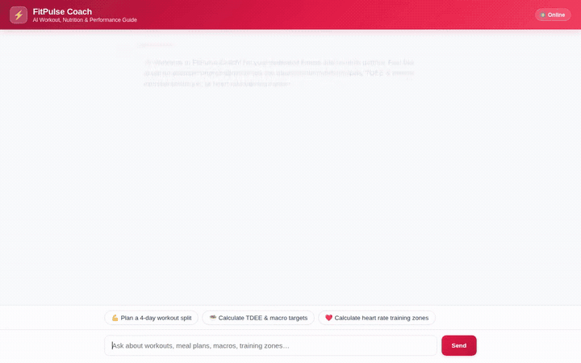

# ⚡ FitPulse Coach

An intelligent fitness and nutrition companion agent built with the Google Agent Development Kit (ADK), Vertex AI, and Google Cloud services. FitPulse Coach helps athletes and fitness enthusiasts structure workouts, track progress, learn exercise mechanics, calculate nutritional targets, and discover nearby training facilities.



---

## 🌟 Implemented Capabilities & Tools

FitPulse Coach connects foundation models with Google Cloud services:

### 1. Long-Term Cross-Session Memory (Vertex AI Memory Bank)
- **Engine**: Vertex AI Agent Platform Memory Bank service.
- **Tools & Callbacks**: `PreloadMemoryTool` and `generate_memories_callback`.
- **Functionality**: Automatically extracts and retains athlete preferences, fitness goals, personal records (PRs), injury history, and strict dietary allergies across chat sessions without requiring repetitive inputs.

### 2. Exercise Catalog & Workout Tracking (Cloud Firestore)
- **Database**: Google Cloud Firestore.
- **Tools**:
  - `list_exercises(muscle_group, difficulty)`: Browse exercise routines filtered by body region or experience level.
  - `get_exercise_details(exercise_name)`: Retrieve movement mechanics, target muscle groups, and form cues.
  - `add_exercise(name, muscle_group, difficulty, equipment, form_cues)`: Add custom movements to the catalog.
  - `log_workout(exercise_name, sets, reps, weight_lbs, notes)`: Log training volume and personal records.
  - `get_recent_workout_logs(limit)`: Review previous training history and volume trends.

### 3. Media Generation & Storage (Google GenAI, Imagen & Cloud Storage)
- **Image Generation (`generate_fitness_image`)**: Generates visual workout milestone badges, PR celebration graphics, and meal plating inspirations via Google Imagen.
- **Video Generation (`generate_exercise_video`)**: Generates short movement demonstrations and form guides using Google's Omni model (`gemini-omni-flash-preview`) in the `global` region.
- **Cloud Storage Persistence**: Saves raw media bytes into a public Google Cloud Storage bucket and registers artifacts in the agent's session context (`tool_context.save_artifact`).

### 4. Code Execution Sandbox (Vertex AI Agent Engine)
- **Engine**: `AgentEngineSandboxCodeExecutor`.
- **Functionality**: Executes sandboxed Python code to compute exact nutritional calculations (Total Daily Energy Expenditure, calorie surpluses/deficits, macro splits) and periodization progression percentages safely.

### 5. Rich UI Card Rendering (A2UI v0.8)
- **Protocol**: Agent-to-User Interface (A2UI v0.8) protocol.
- **Callback**: `a2ui_callback` converts structured model plans into rich interactive cards, columns, rows, images, and workout summary tables.

### 6. Training & Discovery Tools
- **Heart Rate Zones (`calculate_heart_rate_zones`)**: Determines Zone 1 through Zone 5 cardiovascular heart rate intervals using Karvonen and standard age-based formulas.
- **Nutrition Database (`get_food_nutrition`)**: Looks up caloric density, protein, carbohydrate, and fat breakdowns for meal planning.
- **Gym & Park Discovery (`geocode_address`, `search_nearby_places`)**: Finds nearby fitness facilities and outdoor training spots via the Google Maps Places API.

*(Note: Cloud Trace latency telemetry mentioned in early planning is planned for future production monitoring).*

---

## 🏗️ Architecture

```
┌─────────────────────────────────────────────────────────────┐
│                      Web Chat Frontend                      │
│   FastAPI Proxy + Responsive Dialogue UI + A2UI Mini-Renderer│
│   (Gym Dark Mode, Live Typing Pulse, Markdown, Copy Action) │
└──────────────────────────────┬──────────────────────────────┘
                               │ A2A Protocol
┌──────────────────────────────▼──────────────────────────────┐
│             FitPulse Coach Agent (Vertex AI ADK)             │
│                     gemini-2.5-flash                        │
├───────────────┬────────────────────────────┬────────────────┤
│  Memory Bank  │    Firestore Database      │  Code Sandbox  │
│ (Preferences) │ (Exercises & Workout Logs) │ (TDEE & Math)  │
├───────────────┼────────────────────────────┼────────────────┤
│    Maps API   │  Imagen 3 & Gemini Omni    │ Cloud Storage  │
│ (Gym Locator) │ (Milestones & Demo Videos) │ (Public Media) │
└───────────────┴────────────────────────────┴────────────────┘
```

---

## 🚀 Running Locally

### Prerequisites
- Python 3.10+
- Google Cloud SDK (`gcloud`) authenticated with project access
- Google Maps API key (optional, for gym locator)

### 1. Environment Setup

```bash
# Clone the repository
cd fitpulse-coach

# Create and activate a virtual environment
python3 -m venv .venv
source .venv/bin/activate

# Install dependencies
pip install -e .
```

### 2. Configure Environment Variables

```bash
export GOOGLE_CLOUD_PROJECT="your-gcp-project-id"
export GOOGLE_CLOUD_LOCATION="us-east1"
export GOOGLE_MAPS_API_KEY="<YOUR_MAPS_API_KEY>" # Optional
```

### 3. Run the Agent Playground (ADK Dev UI)

To test the agent directly in the ADK playground:

```bash
adk web --app app
```

### 4. Run the Chat Frontend Locally

To run the custom FastAPI chat frontend with the themed dialogue layout, quick-action prompts, and Gym Dark Mode:

```bash
cd frontend

# Set the deployed Agent Engine resource name and agent directory
export AGENT_ENGINE_RESOURCE_NAME="projects/YOUR_PROJECT_ID/locations/us-east1/reasoningEngines/YOUR_ENGINE_ID"
export AGENT_DIRECTORY="app"
export PORT=8080

# Install frontend dependencies and launch
pip install -r requirements.txt
python main.py
```

Open your browser and navigate to the local port configured (default: `http://localhost:8080`).

---

## 🧪 Testing

Run the automated test suite with pytest:

```bash
pytest tests/unit/
```

---

## 📄 License
Apache 2.0
